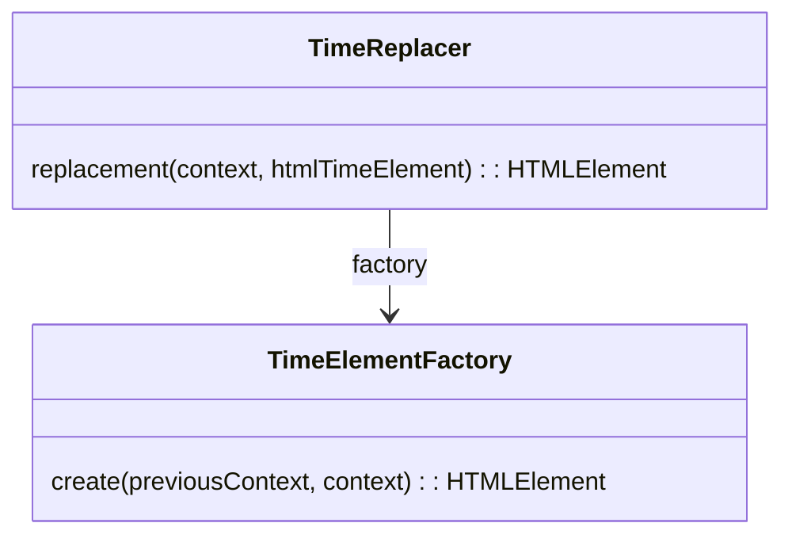
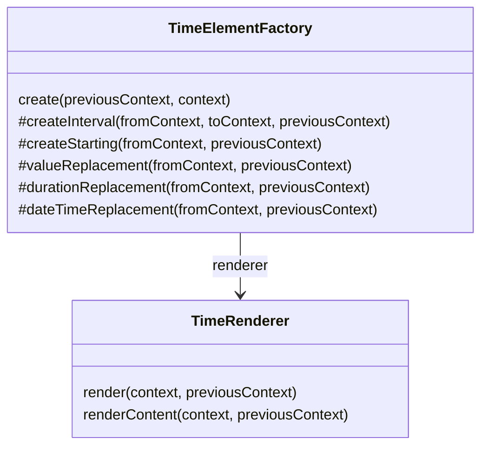
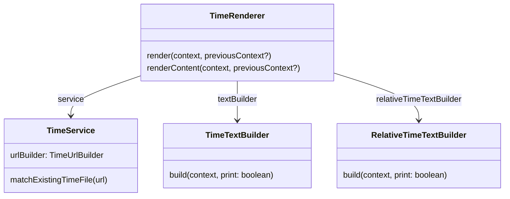

# RR0 CMS Time HTML rendering API

This API allows to render time as HTML in absolute or relative ways.

It relies on [**@ssg-api**](https://www.npmjs.com/package/ssg-api) to perform replacements in HTML pages/templates.

HTML support here is about replacing `<time>` tags:

- **dates** like `<time>1972-08-12</time>` with links toward an existing page about this time.
- date **intervals** (open or not) like `<time>1972/1974</time>` with a couple of links as above.
- **durations** like `<time>P2H3M</time>` with resolved duration texts.

The [`TimeReplacer`](html/TimeReplacer.ts) is a [**@ssg-api**](https://www.npmjs.com/package/ssg-api) replacer to for `<time>` tags that calls
the [TimeElementFactory](#TimeElementFactory) to create proper replacements depending on the detected contexts:

## TimeElementFactory

The [`TimeElementFactory`](html/TimeElementFactory.ts) will ask [@rr0/time](https://www.npmjs.com/package/@rr0/time) to parse the `<time>` tag contents to either create an element rendering:

- an HTML interval, either:
    - closed (`createInterval()` building an element like "between x and y") or
    - open (`createStarting()` building an element like "starting x")
- a date (fuzzy or not) `valueReplacement()` building en element like

Depending on those cases, it will call the [`TimeRenderer`](#TimeRenderer) with different parameters.

## TimeRenderer

The [TimeRenderer](html/TimeRenderer.ts) is responsible for `render`ing the actual HTML elements for given `TimeContext`s.

To do so, it creates elements and put inside time-related text generated by a [`TimeTextBuilder`](#TimeTextBuilder).
If a `previousContext` was provided, a *relative* rendering will be performed by a `RelativeTimeBuilder` to provide a time expression *relative* to it.

## Approximation

An approximate time is told as EDTF scopes its qualification:
- written after the time, it applies to the whole date and time: `<time>2023-10-12 19:00~</time>` is rendered "vers le jeudi 12 à 19 h" ("around …" in English), or "vers 19 h" when only the hour differs from the previous time;
- written before the hour, it applies to the time of day only: `<time>2023-10-12 ~19:00</time>` is rendered "jeudi 12 vers 19 h".

An approximation already written right before the time ("vers <time>…~</time>", "environ", "around") is not told again,
and one that would come right after a preposition ("le vers jeudi 12") is not told before the time.
An approximate time is never rendered with a relative wording ("une heure plus tard"), which could not tell it.

## Context

Each time is the context that the next one is rendered relatively to ("19 h" after "jeudi 12"),
except a time of a source (``) or one marked `data-context="none"`, which a narrative does not follow.

## Time zones

A time zone that follows a time is read as [@rr0/time](https://www.npmjs.com/package/@rr0/time) writes it, right after the time (`21:45EST`), whatever way it is written in the page:
`<time>1968-08-02 21:45 (EST)</time>` and `<time>1968-08-02 21:45 EST</time>` are both read as `21:45EST`.
Only the time zones that @rr0/time knows are read that way. Anything else remains text around the time, like the `(LST)` (local sidereal time, which is no time zone) of `<time>15:40 (LST)</time>`.

## `datetime` and `data-edtf`

The `datetime` attribute of the `<time>` elements that are created holds what HTML can read (`2004-06-11T09:12:33+01:00`, `PT2H`), as built by [`HtmlDatetime`](HtmlDatetime.ts).
HTML knows neither the qualifications of EDTF (`2004-~06`, `~P2H`) nor its time zones (`+01`), nor durations in years or months, so the time as @rr0/time writes it
is kept in a `data-edtf` attribute, which is only set when it is not what `datetime` holds. When HTML has no equivalent at all (a duration in months), there is only `data-edtf`.
